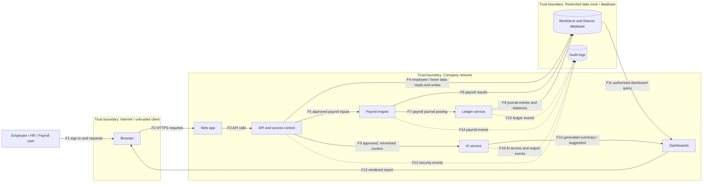

# STRIDE Threat Model: Aura Workforce (AS-02)

**Status:** Draft for review against the assessment architecture and Task 1 workbook.

## 1. Data-flow diagram

The diagram below follows the supplied template: user → web → API → database, plus payroll engine, ledger, AI service, and dashboards. Dashed subgraphs mark trust boundaries.



### Trust boundaries
- **Internet / untrusted client:** browser and user-supplied values; do not trust client-side checks alone.
- **Company network:** web app, API, payroll engine, ledger, AI service, and dashboards. Internal services still need identity and access checks.
- **Restricted data zone / database:** employee, payroll, finance, and audit data. Apply least privilege, encryption, backups, and monitored access.

## 2. Six STRIDE questions

- **S — Spoofing:** Could someone pretend to be a user or service?
- **T — Tampering:** Could someone alter a request, record, calculation, or result?
- **R — Repudiation:** Could an action occur without reliable evidence of who performed it?
- **I — Information disclosure:** Could sensitive information be exposed to an unauthorised person or service?
- **D — Denial of service:** Could a component be overloaded or made unavailable?
- **E — Elevation of privilege:** Could someone gain more permissions than their role should allow?

The table marks the most relevant STRIDE category for each threat. A dash means that category is not the main scenario for that row; it does not mean the category can never apply to that component.

## 3. STRIDE threat table (30 threats)

| ID | Component / flow | S Spoofing | T Tampering | R Repudiation | I Info disclosure | D Denial of service | E Elevation | Mitigation idea |
|---|---|---|---|---|---|---|---|---|
| T-01 | Login → API | Compromised account impersonates an employee. | — | — | — | — | — | Require MFA, secure sessions, rate limits, and alerts for unusual sign-ins. |
| T-02 | Web app → API | API accepts a forged or incorrectly validated identity token. | — | — | — | — | — | Verify token signature, issuer, audience, expiry, and service identity server-side. |
| T-03 | API → database: employee record lookup | — | — | — | Employee accesses another employee's restricted record by changing an ID. | — | Unauthorised object access bypasses role boundaries. | Enforce object-level authorisation on every request; test cross-employee access. |
| T-04 | Employee profile update | — | Employee changes fields they are not permitted to edit. | — | — | — | — | Apply field-level permissions, input validation, and audited update workflows. |
| T-05 | API response → browser | — | — | — | API returns unnecessary personal fields such as `employees.date_of_birth`. | — | — | Use response allowlists, minimise fields, and mask restricted data by role. |
| T-06 | Employee data change → audit log | — | — | A sensitive change has no reliable actor/time record, so it can be denied later. | — | — | — | Log actor, timestamp, action, target, outcome, and correlation ID in protected storage. |
| T-07 | Browser → web/API | — | — | — | — | Repeated or oversized requests exhaust API or database resources. | — | Apply rate limits, request-size limits, timeouts, quotas, and monitoring. |
| T-08 | API role check | — | — | — | — | — | A standard user obtains HR/payroll functions through stale or overly broad permissions. | Deny by default, centralise role checks, review role changes, revoke stale sessions. |
| T-09 | API → payroll engine | — | Payroll inputs are changed between approval and calculation. | — | — | — | — | Authenticate service calls, validate approved input versions, and reconcile totals. |
| T-10 | Payroll run request | An unauthorised service pretends to be the payroll scheduler or API. | — | — | — | — | — | Use workload identities, mutual authentication, and an allowlist of authorised callers. |
| T-11 | Payroll engine → database | — | Calculated salary, deductions, or net pay is modified before persistence. | — | — | — | — | Use transaction controls, integrity checks, approval gates, and reconciliation. |
| T-12 | Payroll report / export | — | — | — | Unauthorised manager sees `payroll_items.net_pay` or `payroll_items.tds`. | — | — | Restrict reports and exports by role, mask values, log downloads, and use expiring links. |
| T-13 | Payroll approval | — | — | Payroll change or approval cannot be tied to a named approver and version. | — | — | — | Preserve approval records, approver identity, timestamp, version, and decision. |
| T-14 | Payroll batch processing | — | — | — | — | Malformed or oversized batch blocks a scheduled payroll run. | — | Validate batches early, bound queues, limit retries, and document recovery steps. |
| T-15 | Payroll engine → ledger | — | Payroll journal entry is duplicated, omitted, altered, or posted to the wrong period. | — | — | — | — | Use idempotency keys, balanced-entry checks, period validation, and reconciliation. |
| T-16 | Payroll engine → ledger service | Fake service identity submits unauthorised journal postings. | — | — | — | — | — | Authenticate service identities and separately authorise ledger posting operations. |
| T-17 | Ledger reversal / audit trail | — | — | Ledger change or reversal lacks a reliable link to the original entry and actor. | — | — | — | Keep append-only audit events and link reversals to original entries with reason and actor. |
| T-18 | Ledger query | — | — | — | Broad query exposes client/vendor finance or tax registration data. | — | — | Limit queries by role and business need; encrypt data and audit bulk reads. |
| T-19 | API → AI service | — | — | — | Unnecessary restricted payroll or employee data is sent to AI prompts or retained in logs. | — | — | Minimise/redact context; review provider retention; block restricted fields unless approved. |
| T-20 | AI prompt / retrieved text | — | Untrusted text manipulates the AI into ignoring intended instructions or producing unsafe output. | — | — | — | — | Treat retrieved text as untrusted, constrain tools, separate instructions from data, validate output. |
| T-21 | AI output → dashboard/workflow | — | — | — | — | — | AI suggestion is treated as an authorised HR or payroll action without normal approval. | Keep AI advisory for sensitive decisions; require human approval and enforce checks in the API. |
| T-22 | AI recommendation audit | — | — | Model version, input references, and reviewer decision are not recorded, preventing investigation. | — | — | — | Log model/version, request ID, approved input references, output, and reviewer decision with minimisation. |
| T-23 | AI service | — | — | — | — | Excessive prompts exhaust quotas or delay workforce functions. | — | Set quotas and timeouts, use circuit breakers, and provide safe fallback behaviour. |
| T-24 | Database → dashboard → browser | — | — | — | Dashboard filters or exports expose records across department/manager boundaries. | — | Row-level access control is missing or bypassed. | Enforce row-level checks server-side for pages, APIs, and exports. |
| T-25 | Dashboard report query | — | Client changes report parameters to alter totals or request another employee group. | — | — | — | — | Validate parameters, calculate totals server-side, and authorise every report query. |
| T-26 | Services → audit logs | — | Attacker or compromised service changes/deletes logs to conceal actions. | — | — | — | — | Send logs to a separate restricted service; use append-only storage and integrity alerts. |
| T-27 | Audit log access | — | — | — | Logs contain full payroll values or personal details and are visible to too many staff. | — | — | Log only needed metadata; redact personal data/secrets; restrict and monitor log access. |
| T-28 | Database backup / spreadsheet export | — | — | — | Backup/export is copied to an unapproved location without equivalent protection. | — | — | Encrypt backups, restrict exports, separate key access, and test retention/deletion controls. |
| T-29 | Service account → database | — | — | — | — | — | Overprivileged service account is abused to read or change unrelated restricted tables. | Use separate least-privilege service identities, rotate credentials, and review permissions. |
| T-30 | Database / service dependency | — | — | — | — | Database outage or connection exhaustion blocks payroll and dashboards. | — | Monitor health/capacity, test recovery, maintain backups, and document payroll continuity. |

## 4. Link to Task 1 assets

The asset names below use exact field names from the provided Task 1 worksheet. Confirm their sensitivity labels against the final completed workbook before submission.

| Asset / field | Why it matters to this model | Threats linked |
|---|---|---|
| `employees.employee_id`, `employees.date_of_birth`, `employees.work_email` | Employee identity and personal information | T-03, T-05, T-27, T-28 |
| `users.username`, `users.role`, `users.mfa_enabled`, `users.is_active` | Account identity and access control | T-01, T-02, T-08, T-29 |
| `salary_revisions.previous_annual_fixed`, `salary_revisions.new_annual_fixed`, `salary_revisions.approved_by` | Salary changes and approval trail | T-04, T-06, T-13 |
| `performance_reviews.performance_rating`, `performance_reviews.rating_label` | Sensitive employee performance information | T-20, T-21, T-22 |
| `leave_requests.reason`, `leave_requests.status`, `leave_requests.approver_id` | Potentially sensitive employee leave details and decisions | T-05, T-20 |
| `payroll_items.monthly_fixed_gross`, `payroll_items.total_deductions`, `payroll_items.net_pay`, `payroll_items.tds` | Payroll amounts and deductions | T-09, T-11, T-12, T-19, T-21, T-28 |
| `journal_entries.total_debit`, `journal_entries.total_credit`, `journal_entries.created_by`, `journal_entries.reversal_of_source_id` | Financial integrity and traceability | T-15, T-17, T-26 |
| `clients.gst_registration`, `vendors.gst_registration` | Client/vendor tax registration data | T-18 |

## 5. Top 10 risk register

Rank is an initial prioritisation based on potential impact and plausible attack path. Likelihood has not been measured, and no claim is made that these issues exist in a real deployment.

| Rank | Threat ID | Impact if realised | Initial priority | Reason |
|---:|---|---|---|---|
| 1 | T-03 | Restricted employee records may be accessed across users. | Critical | A single object-authorisation defect can expose many employee records. |
| 2 | T-09 | Payroll inputs may be changed before calculation. | Critical | Could affect employee pay and downstream accounting records. |
| 3 | T-11 | Payroll calculations/results may be altered. | Critical | Directly threatens integrity of gross pay, deductions, and net pay. |
| 4 | T-19 | Restricted data may cross into the AI service or its logs. | Critical | Creates an additional data-processing boundary and potential retention exposure. |
| 5 | T-12 | Payroll data may be disclosed through reports or exports. | Critical | Compensation and deduction data are highly sensitive. |
| 6 | T-15 | Ledger postings may be duplicated, altered, or omitted. | Critical | Can undermine financial records and reconciliation. |
| 7 | T-24 | Dashboard users may see records outside their authorised scope. | Critical | UI-only filtering can fail if server-side checks are absent. |
| 8 | T-28 | Backups/exports may expose large amounts of sensitive data. | Critical | Copies can bypass normal application access controls. |
| 9 | T-08 | Users may gain HR/payroll permissions beyond their role. | Critical | Excessive permissions enable sensitive workflows and data access. |
| 10 | T-29 | Compromised service account may access unrelated restricted tables. | Critical | A broad service identity increases the blast radius of compromise. |

### Ranking explanation

The top ten prioritise potential harm to employee privacy, payroll accuracy, and financial integrity. T-03 is ranked first because a broken object-level authorisation check can allow one user to access another person's restricted records. T-09 and T-11 can affect payroll inputs and outputs, while T-15 threatens the accuracy of financial postings. T-19 is high priority because AI processing can create a separate data-handling boundary. T-12, T-24, and T-28 cover common disclosure paths through reports, dashboards, and exported copies. T-08 and T-29 address excessive privileges at user and service levels. This is an initial design ranking and should be updated when likelihood, existing controls, and confirmed business impact are known.

## 6. Think for yourself: the most dangerous arrow

**My initial choice is F5: API → payroll engine (approved payroll inputs).** If an attacker could tamper with or impersonate this flow, the result could affect Restricted payroll fields such as `payroll_items.monthly_fixed_gross`, `payroll_items.total_deductions`, and `payroll_items.net_pay`, and could flow into the ledger. That combines potential employee financial harm with accounting integrity risk. Controls should include service authentication, operation-level authorisation, validation of approved input versions, approval records, and reconciliation before ledger posting. Confirm this is the right arrow for the actual design; if the architecture works differently, update the answer.

## 7. Evidence checklist

- [ ] Export or screenshot the diagram with all three trust boundaries visible.
- [ ] Screenshot the first 10 rows of the STRIDE table.
- [ ] Keep this document in `docs/`.
- [ ] Save evidence screenshots in `evidence/`.
- [ ] Check all linked fields and sensitivity labels against the final Task 1 workbook.
- [ ] Compare this draft with `06_Templates/threat_model_template.md` and preserve any extra requirements in the original template.
- [ ] Review the assumptions, threats, and ranking before submission.

## 8. References

- OWASP Threat Dragon: https://github.com/OWASP/threat-dragon
- OWASP pytm: https://github.com/OWASP/pytm
- OWASP Cheat Sheet Series: https://github.com/OWASP/CheatSheetSeries

## 9. Suggested commit

```bash
git add docs/ evidence/
git commit -m "Add Aura Workforce STRIDE threat model"
git push
```
