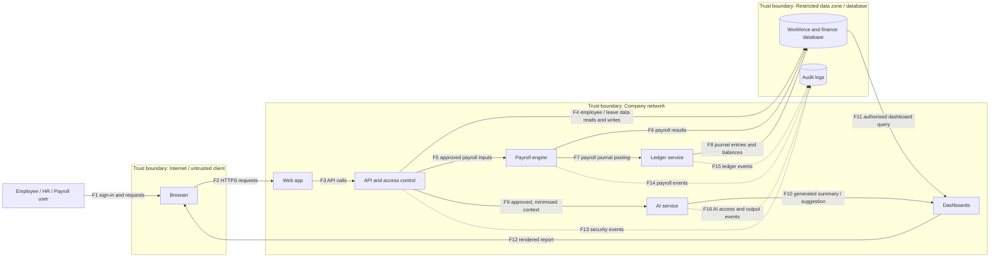

# STRIDE Threat Model: Aura Workforce (AS-02)

**Status:** Draft for review against the assessment architecture and Task 1 workbook.

## 1. Data-flow diagram

The diagram below follows the supplied template: user → web → API → database, plus payroll engine, ledger, AI service, and dashboards. Dashed subgraphs mark trust boundaries.



### Trust boundaries
- **Internet / untrusted client:** browser and user-supplied values; do not trust client-side checks alone.
- **Company network:** web app, API, payroll engine, ledger, AI service, and dashboards. Internal services still need identity and access checks.
- **Restricted data zone / database:** employee, payroll, finance, and audit data. Apply least privilege, encryption, backups, and monitored access.

## 2. Six STRIDE questions

- **S — Spoofing:** Could someone pretend to be a user or service?
- **T — Tampering:** Could someone alter a request, record, calculation, or result?
- **R — Repudiation:** Could an action occur without reliable evidence of who performed it?
- **I — Information disclosure:** Could sensitive information be exposed to an unauthorised person or service?
- **D — Denial of service:** Could a component be overloaded or made unavailable?
- **E — Elevation of privilege:** Could someone gain more permissions than their role should allow?

The table marks the most relevant STRIDE category for each threat. A dash means that category is not the main scenario for that row; it does not mean the category can never apply to that component.

## 3. STRIDE threat table (30 threats)

| ID | Component / flow | S Spoofing | T Tampering | R Repudiation | I Info disclosure | D Denial of service | E Elevation | Mitigation idea |
|---|---|---|---|---|---|---|---|---|
| T-01 | Login → API | Compromised account impersonates an employee. | — | Login events lack sufficient records to investigate disputed access. | Login errors reveal whether an employee account exists. | Repeated login requests overload the authentication service. | Manipulated authentication flow grants an incorrect role. | Require MFA, use consistent login errors, protect audit logs, rate-limit requests, and enforce server-side role checks. |
| T-02 | Web app → API | API accepts a forged or incorrectly validated identity token. | Client modifies request parameters to attempt to bypass server-side validation. | Authentication and request decisions cannot be traced to reliable logs. | API responses expose identity tokens or unnecessary personal data. | Repeated or oversized API requests exhaust service resources. | An identity token or role claim grants permissions beyond the user’s assigned role. | Verify token signature, issuer, audience, and expiry; validate inputs; protect logs; minimise responses; rate-limit requests; enforce server-side permissions. |
| T-03 | API → database: employee record lookup | A caller impersonates an authorised user or service. | An unauthorised request changes an employee record. | Employee record access or changes cannot be traced to the actor. | Employee accesses another employee’s restricted record by changing an ID. | Repeated or expensive lookups exhaust database resources. | Unauthorised object access bypasses role boundaries. | Authenticate callers; enforce object-level authorisation on every request; validate updates; audit access and changes; apply query limits and timeouts. |
| T-04 | Employee profile update | An attacker uses another employee’s account to submit an update. | Employee changes fields they are not permitted to edit. | Profile changes lack a reliable record of the actor, time, and previous value. | Profile updates expose restricted fields in responses or error messages. | Repeated update requests overload the profile service. | A user changes protected HR fields by exploiting excessive permissions. | Require authentication; apply field-level permissions and input validation; keep protected change logs; minimise responses; rate-limit requests; review roles. |
| T-05 | API response → browser | — | — | — | API returns unnecessary personal fields such as `employees.date_of_birth` or restricted payroll data. | Repeated requests for large responses exhaust API resources. | — | Use response allowlists, minimise fields, mask restricted data by role, and enforce response-size limits and rate limits. |
| T-06 | Employee data change → audit log | — | An attacker alters or deletes audit records to conceal an unauthorised change. | A sensitive change has no reliable actor/time record, so it can be denied later. | Audit logs expose restricted personal or payroll information to unauthorised readers. | Excessive event generation fills log storage and prevents important events from being recorded. | — | Record actor, timestamp, action, target, and outcome; restrict log modification; use protected append-only storage; redact sensitive fields; monitor log capacity. |
| T-07 | Browser → web/API | — | Malformed requests attempt to alter submitted data or bypass validation. | Request activity cannot be reliably linked to a user or session. | Error responses expose internal details or personal information. | Repeated or oversized requests exhaust API or database resources. | Crafted requests exploit weak permission checks to access privileged functions. | Validate inputs server-side; authenticate requests; protect audit logs; return safe errors; apply request-size limits, rate limits, timeouts, and server-side authorisation. |
| T-08 | API role check | A user or service impersonates an identity with higher privileges. | A user changes role-related request fields to try to bypass permission checks. | Role changes and privileged actions cannot be traced to an accountable actor. | Users can view permissions or restricted data belonging to other roles. | Repeated authorisation requests overload the API. | A standard user obtains HR/payroll functions through stale or overly broad permissions. | Deny by default; centralise server-side role checks; ignore client-supplied role claims unless validated; audit role changes; limit requests; revoke stale sessions. |
| T-09 | API → payroll engine | An unauthorised caller impersonates an approved API or service. | Payroll inputs are changed between approval and calculation. | Payroll requests and calculation decisions cannot be traced to the initiating actor. | Payroll inputs or results are exposed to an unauthorised service or user. | Excessive payroll requests delay or prevent payroll processing. | A service with limited permissions invokes privileged payroll functions. | Authenticate service calls; validate approved input versions; log payroll requests and decisions; restrict payroll data; apply quotas and timeouts; enforce least privilege; reconcile totals. |
| T-10 | Payroll run request | An unauthorised service pretends to be the payroll scheduler or API. | A request changes payroll-run parameters or the intended processing period. | Payroll run initiation and approval cannot be linked to a named actor. | Payroll run responses reveal restricted employee or salary information. | Repeated or oversized requests block scheduled payroll processing. | A caller without payroll privileges triggers or approves a payroll run. | Use workload identities and mutual authentication; validate run parameters; log initiation and approval; minimise responses; apply quotas and timeouts; require explicit payroll-run permissions. |
| T-11 | Payroll engine → database | An unauthorised service impersonates the payroll engine. | Calculated salary, deductions, or net pay is modified before persistence. | Payroll database changes cannot be linked to a specific run or actor. | Unauthorised access exposes salary, deductions, or net pay. | Repeated writes or transactions exhaust database resources. | A payroll service account gains write access beyond its assigned tables or operations. | Authenticate service identities; validate calculations and approved versions; use transactions and integrity checks; audit changes; restrict data access; limit database resources; enforce least privilege. |
| T-12 | Payroll report / export | An attacker uses another user’s account to access payroll reports. | Export parameters are altered to change the report scope or contents. | Report downloads and exports cannot be traced to the requesting user. | Unauthorised manager sees `payroll_items.net_pay` or `payroll_items.tds`. | Excessive report generation or exports exhaust reporting resources. | A manager or employee obtains payroll export permissions they should not have. | Restrict reports and exports by role; validate report parameters; mask restricted values; log downloads; apply quotas; use expiring links; review export permissions. |
| T-13 | Payroll approval | An attacker impersonates an authorised payroll approver. | An approval decision or payroll change is modified after approval. | Payroll change or approval cannot be tied to a named approver and version. | Approval screens expose restricted payroll information to unauthorised users. | Repeated approval requests delay payroll processing. | A user without approval authority approves a payroll change. | Require strong approver authentication; protect approval records; bind approvals to specific versions; log actor, time, and decision; restrict displayed data; apply request limits; separate duties. |
| T-14 | Payroll batch processing | An unauthorised caller impersonates a batch-processing service. | Batch records are altered or duplicated before processing. | Batch execution and failures cannot be linked to a specific request or actor. | Batch errors or logs expose restricted employee and payroll data. | Malformed or oversized batch blocks a scheduled payroll run. | A batch service processes operations beyond its assigned permissions. | Authenticate service callers; validate batch contents and integrity; use unique batch IDs; log execution outcomes; redact sensitive logs; bound queues and retries; enforce least privilege. |
| T-15 | Payroll engine → ledger | An unauthorised service impersonates the payroll engine when submitting a journal entry. | Payroll journal entry is duplicated, omitted, altered, or posted to the wrong period. | A ledger posting cannot be traced to its initiating payroll run or actor. | Journal entries expose restricted financial or payroll details to unauthorised users. | Repeated posting requests overload the ledger service or delay processing. | A payroll service gains permission to perform unrelated ledger operations. | Authenticate service identities; use idempotency keys; validate posting periods and balanced entries; audit requests; restrict ledger queries; limit requests; enforce least privilege. |
| T-16 | Payroll engine → ledger service | Fake service identity submits unauthorised journal postings. | Posting requests are modified or replayed to create incorrect ledger entries. | Service identity and posting decisions are not reliably recorded. | Ledger responses reveal financial data to an unauthorised service. | Repeated posting requests exhaust ledger service resources. | A service can post entries or reverse transactions beyond its assigned permissions. | Authenticate service identities; validate request integrity and replay protection; log service identity and outcomes; minimise responses; apply quotas; separately authorise posting and reversal operations. |
| T-17 | Ledger reversal / audit trail | An unauthorised user impersonates a ledger operator. | A ledger entry or reversal is altered without proper authorisation. | Ledger change or reversal lacks a reliable link to the original entry and actor. | Audit details or financial records are exposed to unauthorised readers. | Repeated reversal requests delay ledger processing. | A user without reversal authority performs a privileged ledger operation. | Restrict reversal permissions; require approval; link reversals to original entries; record actor, timestamp, reason, and decision; protect audit logs; apply request limits; enforce least privilege. |
| T-18 | Ledger query | An attacker uses another user’s account to query ledger records. | Client changes query parameters to request altered or unauthorised report results. | Ledger queries and bulk exports cannot be traced to the requesting user. | Broad query exposes client/vendor finance or tax registration data. | Excessive or expensive queries exhaust database resources. | A user accesses ledger records or administrative functions beyond their assigned permissions. | Enforce role- and business-based query access; validate parameters; audit queries and bulk reads; minimise returned fields; use query limits and timeouts; review privileges. |
| T-19 | API → AI service | An unauthorised caller impersonates an approved AI client. | Untrusted input alters the intended AI request context or parameters. | AI requests and responses cannot be traced to a request ID or responsible caller. | Unnecessary restricted payroll or employee data is sent to AI prompts or retained in logs. | Excessive AI requests exhaust quotas or delay workforce functions. | The AI service is granted tools or permissions beyond its intended purpose. | Authenticate callers; validate request parameters; record request IDs; minimise and redact context; review provider retention; set quotas and timeouts; restrict AI tools and permissions. |
| T-20 | AI prompt / retrieved text | An attacker disguises untrusted text as trusted instructions or system content. | Untrusted text manipulates the AI into ignoring intended instructions or producing unsafe output. | Prompt inputs, retrieved sources, and model responses cannot be linked for later investigation. | AI output reveals restricted information contained in prompts or retrieved text. | Excessively long or repeated prompts consume model resources. | Prompt manipulation causes the AI to invoke tools or recommend actions beyond its authorised scope. | Treat retrieved text as untrusted; separate instructions from data; constrain tools; minimise sensitive context; validate outputs; limit prompt size and frequency; log relevant events safely. |
| T-21 | AI output → dashboard/workflow | An attacker impersonates an authorised user to submit an AI-generated recommendation. | AI output is altered before it reaches the dashboard or workflow. | AI recommendations and reviewer decisions cannot be traced to a request or responsible user. | AI output displays restricted employee or payroll information. | Repeated AI output processing delays dashboard or workflow operations. | An AI suggestion is treated as an authorised HR or payroll action without the normal approval process. | Validate AI output; protect data in transit; log request IDs and reviewer decisions; restrict sensitive fields; apply resource limits; require human approval and normal permission checks before actions. |
| T-22 | AI recommendation audit | — | Audit details are altered to misrepresent an AI recommendation or its review. | Model version, input references, and reviewer decision are not recorded, making the recommendation difficult to investigate. | Audit records expose sensitive prompt content or employee data to unauthorised readers. | Excessive audit events fill storage and prevent important events from being recorded. | — | Record request ID, model version, relevant input references, output, reviewer decision, and timestamp; restrict log access; protect records from alteration; redact sensitive content; monitor storage capacity. |
| T-23 | AI service | An unauthorised caller impersonates an approved AI client. | AI service configuration or request parameters are changed without approval. | AI service requests, errors, and administrative changes cannot be traced to a responsible actor. | AI responses or logs reveal sensitive prompt data or employee information. | Excessive prompts exhaust service quotas or delay workforce functions. | An AI service identity gains access to tools or data beyond its approved scope. | Authenticate service clients; restrict configuration changes; protect audit logs; redact sensitive data; enforce quotas and timeouts; review service permissions. |
| T-24 | Database → dashboard → browser | An attacker uses another user’s session to access the dashboard. | Client-side filters or displayed totals are altered to misrepresent database results. | Dashboard views and exports cannot be traced to the requesting user. | Dashboard filters or exports expose records across department or manager boundaries. | Large dashboards or repeated queries exhaust database or application resources. | Missing or bypassed row-level access controls allow users to view records outside their permitted scope. | Authenticate sessions; calculate sensitive totals server-side; log access and exports; enforce server-side row-level permissions; minimise returned fields; apply query limits and timeouts. |
| T-25 | Dashboard report query | An attacker impersonates a user with access to restricted reports. | A client changes report parameters to alter displayed totals or request another employee group. | Report requests and exports cannot be traced to the requesting user. | Report results expose personal, payroll, or departmental data beyond the user’s access rights. | Expensive or repeated report queries exhaust application or database resources. | A user bypasses report permissions to access restricted records or administrative functions. | Authenticate users; validate report parameters server-side; calculate totals from authorised data; enforce row-level permissions; audit queries and exports; apply query limits and timeouts. |
| T-26 | Services → audit logs | A compromised service impersonates another service in audit events. | An attacker or compromised service changes or deletes logs to conceal actions. | Missing or incomplete audit events prevent actions from being attributed to an actor. | Logs contain sensitive personal or payroll data accessible to unauthorised readers. | Excessive event generation fills log storage and prevents important events from being recorded. | A service account obtains permission to administer or disable audit logging beyond its assigned role. | Authenticate log sources; restrict log modification and deletion; use centralised tamper-resistant storage; record actor and timestamp; redact sensitive fields; monitor capacity; separate logging administration from service accounts. |
| T-27 | Audit log access | An attacker uses another user’s account to access audit logs. | An unauthorised user alters log search parameters or exported records to misrepresent events. | Audit access and exports cannot be traced to the requesting user. | Logs contain full payroll values or personal details visible to too many staff. | Large log searches or repeated exports exhaust logging resources. | A user obtains permission to administer, alter, or delete logs beyond their assigned role. | Restrict log access by role; protect original records from alteration; audit searches and exports; redact sensitive fields; apply query limits; separate log reading from administration privileges. |
| T-28 | Database backup / spreadsheet export | An unauthorised user impersonates an approved backup or export operator. | Backup files or exported spreadsheet contents are altered without detection. | Backup creation, copying, and export activity cannot be traced to an accountable user. | A backup or spreadsheet is copied to an unapproved location without equivalent protection. | Large or repeated backup and export jobs consume storage, bandwidth, or processing capacity. | A service account or user obtains backup access or restore privileges beyond its assigned role. | Encrypt backups and exports; restrict destinations and access; verify file integrity; log creation and transfers; define retention and deletion rules; monitor resource use; separate backup and restore permissions. |
| T-29 | Service account → database | An attacker uses stolen service credentials to impersonate an authorised service. | A compromised service account modifies database records outside its approved duties. | Database actions cannot be traced to a specific service identity or request. | An overprivileged service account reads unrelated restricted tables or sensitive records. | Excessive database requests from a service account exhaust database connections or resources. | An overprivileged service account is abused to read or change tables beyond its assigned permissions. | Use unique service identities; store credentials securely; grant least-privilege database permissions; restrict table and operation access; audit database activity; rotate credentials; monitor connection limits. |
| T-30 | Database / service dependency | A malicious or unauthorised service impersonates a trusted database dependency. | Database configuration or stored records are altered without approval. | Database outages and service failures lack sufficient records to identify their cause. | Database errors or diagnostic logs reveal connection details or sensitive records. | Database outages, connection exhaustion, or dependency failures block payroll and dashboard functions. | A compromised dependency receives database or service privileges beyond its intended role. | Authenticate service connections; control configuration changes; protect diagnostic logs; monitor availability and connection pools; configure timeouts and recovery; test backups and failover; enforce least privilege. |

## 4. Link to Task 1 assets

The asset names below use exact field names from the provided Task 1 worksheet. Confirm their sensitivity labels against the final completed workbook before submission.

| Asset / field | Why it matters to this model | Threats linked |
|---|---|---|
| `employees.employee_id`, `employees.date_of_birth`, `employees.work_email` | Employee identity and personal information | T-03, T-05, T-27, T-28 |
| `users.username`, `users.role`, `users.mfa_enabled`, `users.is_active` | Account identity and access control | T-01, T-02, T-08, T-29 |
| `salary_revisions.previous_annual_fixed`, `salary_revisions.new_annual_fixed`, `salary_revisions.approved_by` | Salary changes and approval trail | T-04, T-06, T-13 |
| `performance_reviews.performance_rating`, `performance_reviews.rating_label` | Sensitive employee performance information | T-20, T-21, T-22 |
| `leave_requests.reason`, `leave_requests.status`, `leave_requests.approver_id` | Potentially sensitive employee leave details and decisions | T-05, T-20 |
| `payroll_items.monthly_fixed_gross`, `payroll_items.total_deductions`, `payroll_items.net_pay`, `payroll_items.tds` | Payroll amounts and deductions | T-09, T-11, T-12, T-19, T-21, T-28 |
| `journal_entries.total_debit`, `journal_entries.total_credit`, `journal_entries.created_by`, `journal_entries.reversal_of_source_id` | Financial integrity and traceability | T-15, T-17, T-26 |
| `clients.gst_registration`, `vendors.gst_registration` | Client/vendor tax registration data | T-18 |

## 5. Top 10 risk register

Rank is an initial prioritisation based on potential impact and plausible attack path. Likelihood has not been measured, and no claim is made that these issues exist in a real deployment.

| Rank | Threat ID | Impact if realised | Initial priority | Reason |
|---:|---|---|---|---|
| 1 | T-03 | Restricted employee records may be accessed across users. | Critical | A single object-authorisation defect can expose many employee records. |
| 2 | T-09 | Payroll inputs may be changed before calculation. | Critical | Could affect employee pay and downstream accounting records. |
| 3 | T-11 | Payroll calculations/results may be altered. | Critical | Directly threatens integrity of gross pay, deductions, and net pay. |
| 4 | T-19 | Restricted data may cross into the AI service or its logs. | Critical | Creates an additional data-processing boundary and potential retention exposure. |
| 5 | T-12 | Payroll data may be disclosed through reports or exports. | Critical | Compensation and deduction data are highly sensitive. |
| 6 | T-15 | Ledger postings may be duplicated, altered, or omitted. | Critical | Can undermine financial records and reconciliation. |
| 7 | T-24 | Dashboard users may see records outside their authorised scope. | Critical | UI-only filtering can fail if server-side checks are absent. |
| 8 | T-28 | Backups/exports may expose large amounts of sensitive data. | Critical | Copies can bypass normal application access controls. |
| 9 | T-08 | Users may gain HR/payroll permissions beyond their role. | Critical | Excessive permissions enable sensitive workflows and data access. |
| 10 | T-29 | Compromised service account may access unrelated restricted tables. | Critical | A broad service identity increases the blast radius of compromise. |

### Ranking explanation

The top ten prioritise potential harm to employee privacy, payroll accuracy, and financial integrity. T-03 is ranked first because a broken object-level authorisation check can allow one user to access another person's restricted records. T-09 and T-11 can affect payroll inputs and outputs, while T-15 threatens the accuracy of financial postings. T-19 is high priority because AI processing can create a separate data-handling boundary. T-12, T-24, and T-28 cover common disclosure paths through reports, dashboards, and exported copies. T-08 and T-29 address excessive privileges at user and service levels. This is an initial design ranking and should be updated when likelihood, existing controls, and confirmed business impact are known.

## 6. Think for yourself: the most dangerous arrow

**My initial choice is F5: API → payroll engine (approved payroll inputs).** If an attacker could tamper with or impersonate this flow, the result could affect Restricted payroll fields such as `payroll_items.monthly_fixed_gross`, `payroll_items.total_deductions`, and `payroll_items.net_pay`, and could flow into the ledger. That combines potential employee financial harm with accounting integrity risk. Controls should include service authentication, operation-level authorisation, validation of approved input versions, approval records, and reconciliation before ledger posting. Confirm this is the right arrow for the actual design; if the architecture works differently, update the answer.

## 7. Evidence checklist

- [ ] Export or screenshot the diagram with all three trust boundaries visible.
- [ ] Screenshot the first 10 rows of the STRIDE table.
- [ ] Keep this document in `docs/`.
- [ ] Save evidence screenshots in `evidence/`.
- [ ] Check all linked fields and sensitivity labels against the final Task 1 workbook.
- [ ] Compare this draft with `06_Templates/threat_model_template.md` and preserve any extra requirements in the original template.
- [ ] Review the assumptions, threats, and ranking before submission.

## 8. References

- OWASP Threat Dragon: https://github.com/OWASP/threat-dragon
- OWASP pytm: https://github.com/OWASP/pytm
- OWASP Cheat Sheet Series: https://github.com/OWASP/CheatSheetSeries

## 9. Suggested commit

```bash
git add docs/ evidence/
git commit -m "Add Aura Workforce STRIDE threat model"
git push
```
